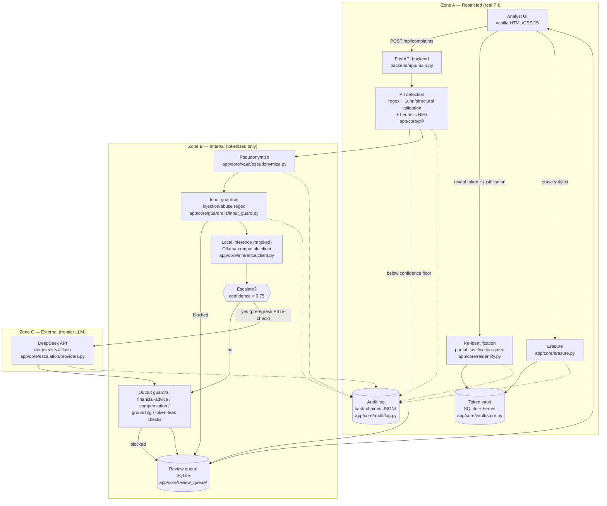

# Sentinel — PDP-Compliant LLM Gateway

Implementation scaffold for [`PRD-pdp-compliant-llm-gateway.md`](./PRD-pdp-compliant-llm-gateway.md). Read the PRD first — this file only explains what exists here and how to run it.

This is a **full scaffold across all six delivery phases** (§12), built in one pass. That means breadth over depth: the compliance-critical mechanics (detection → tokenization → guardrails → escalation → re-identification → audit → erasure) are real and verified end-to-end against a live server, while the two things that make this an *LLM* gateway rather than a pure text pipeline — a real local model and real AWS infrastructure — are stubbed with clearly-marked mocks. See "What's real vs. stubbed" below before you trust any specific piece of it.

## Workflow


AI-generated illustrated overview of the pipeline. Useful for the big picture, but it has a few inaccuracies worth knowing before you cite it: it labels **OpenRouter** as the escalation fallback (the real fallback is `MockEscalationProvider`, not OpenRouter — see `providers.py`), **GitLab CI/CD** (this project has no CI configured at all; the OIDC role in `infra/github_oidc.tf` is scoped for *GitHub* Actions), and **Docker Compose** / a **Makefile** (neither exists in this repo — local dev is a plain venv + `uvicorn` + `python -m http.server`, see "Running it locally" below). The Mermaid diagram below is the accurate version — every node in it is a real file in this repo.

Request flow through the system as actually built (local dev stack — see the [infra](#infra) section for how this maps onto the target AWS architecture in §11). Trust zones (§6.1) are the subgraphs; every node is labelled with the real tool/module behind it, not the aspirational one.



**Tech stack**

| Layer | Tools |
|---|---|
| Backend framework | FastAPI, Uvicorn, Pydantic v2 (`pydantic-settings` for config) |
| Frontend | Vanilla HTML/CSS/JS, no build step, no framework |
| PII detection | Python `re`, hand-rolled structural validation (NIK date/province encoding, Luhn), heuristic NER |
| Storage (local stand-ins for AWS) | SQLite (vault, app db, cost ledger, review queue), `cryptography`'s Fernet (vault encryption-at-rest), JSONL (audit log) |
| Escalation LLM | DeepSeek API (`deepseek-v4-flash`), OpenAI-compatible chat completions, called via `httpx` |
| Local LLM (target, not yet live) | Ollama-compatible endpoint, SEA-LION v4 4B per PRD §6.3 |
| Testing | pytest (22 unit tests) |
| Eval | Custom Python scoring scripts (recall/precision, injection catch rate) against a template-generated synthetic corpus |
| Infra (target AWS architecture) | Terraform, VPC + NAT + endpoints, Lambda + API Gateway, ECS Fargate, DynamoDB, S3 (+ Object Lock), KMS, CloudTrail, Secrets Manager, CloudFront, AWS Budgets |

## Screenshots

Captured from a live run: frontend served via CloudFront (`frontend/` synced to S3), calling a locally-run backend with real DeepSeek escalation; AWS Console shots taken right after `terraform apply` before the verification `terraform destroy`.

| App | Description |
| --- | --- |
|  | New complaint submission — Indonesian complaint text with NIK, phone, email, submitted through the CloudFront-hosted frontend |
|  | Detail view — PII fully tokenized (`[ORANG_1]`, `[NIK_1]`, `[ALAMAT_1]`, `[TELEPON_1]`, `[EMAIL_1]`), triage result, re-identify controls |
|  | Compliance dashboard — data residency report (F8.3), incident scope query (F8.5), subject access + erasure panels |
|  | Complaint queue — live jobs with category/severity produced by real DeepSeek escalation |

| AWS Console | Description |
| --- | --- |
|  | VPC — `sentinel-vpc` (10.42.0.0/16) deployed in `ap-southeast-3` |
|  | S3 — all 6 buckets (audit log, CloudTrail logs, frontend, policy corpus, raw docs, tokenized docs), region-scoped |
|  | DynamoDB — `sentinel-vault`, `sentinel-triage-results`, `sentinel-cost-ledger`, all Active |
|  | CloudTrail — `sentinel-trail`, logging enabled, log file validation enabled |

## Directory map

| Path | PRD section | Status |
|---|---|---|
| `backend/app/core/pii/` | F2, Appendix A | Functional — rule-based (NIK/NPWP/KK/BPJS/card/phone/email/plat/DOB) + heuristic NER (name/address/employer) |
| `backend/app/core/vault/` | F3 | Functional — SQLite+Fernet locally, stands in for DynamoDB+KMS CMK |
| `backend/app/core/inference/` | F4, §6.3 | Structurally complete; **defaults to a mock client** (no live model wired up) |
| `backend/app/core/guardrails/` | F6 | Functional — regex/keyword baseline, sized for the §10.4 red team |
| `backend/app/core/escalation/` | F5 | Functional — circuit breaker, kill switch, pre-egress PII re-check, cost ledger; **defaults to a mock provider** |
| `backend/app/core/reidentify.py` | F7 | Functional — partial re-id, justification-gated, audit-logged |
| `backend/app/core/audit/` | F8 | Functional — hash-chained JSONL (local stand-in for S3 Object Lock), residency/subject-access/incident-scope reports |
| `backend/app/core/review_queue/` | F9 | Functional |
| `backend/app/routers/`, `frontend/` | F10 | Functional — FastAPI + vanilla HTML/CSS/JS, verified in-browser-equivalent via live HTTP calls |
| `backend/tests/` | — | 22 pytest unit tests: NIK/card structural validation + collision handling, guardrail blocking, vault/pseudonymize/erasure round-trips |
| `eval/` | §10 (Phase 0) | Functional — synthetic corpus generator, PII/injection red teams, M1-M4 scoring scripts |
| `infra/` | §11 (Phase 3) | Verified: applied end-to-end to a real AWS account (`ap-southeast-3`), then destroyed. State is **local**, not S3+DynamoDB (see below) |

## What's real vs. stubbed

**Real, and verified live** (ingest → detect → tokenize → guard → infer → escalate → guard → review → reidentify → erase, all exercised over HTTP against a running server during this build):
- Indonesian PII detection with structural validation for NIK/NPWP/KK/BPJS/card (Luhn)/phone/email/plat nomor, overlap-resolved against a heuristic NER baseline for names/addresses/employer.
- Pseudonymization with within-document referential consistency, token vault with encryption-at-rest simulation, single-call erasure that orphans every derived token.
- Input guardrails (Indonesian + English injection patterns, abuse flagging) and output guardrails (financial-advice block, compensation-commitment block, grounding check, token-leakage scan).
- Escalation routing: confidence threshold, circuit breaker, kill switch (degrades to local-only, verified), pre-egress redundant PII check, cost ledger.
- Re-identification: Zone-A-only, permission-gated, partial-field support, every access audited with actor/subject/justification.
- Audit log: hash-chained for tamper evidence, residency report, per-subject access report, incident scope query, per-item compliance view.
- Analyst UI: queue, detail view with token highlighting and inline re-identification, accept/edit/reject, compliance dashboard with erasure tool and runtime kill-switch/threshold controls.

**Stubbed, on purpose, and clearly marked in code:**
- **Local tier** (`settings.use_mock_local_inference`, default `True`) is still mocked — no live SEA-LION/Ollama endpoint. Its heuristic classifier always returns 0.55 confidence, which is below the escalation threshold (0.75), so every complaint currently escalates.
- **Escalation tier** calls **real DeepSeek** (`backend/app/core/escalation/providers.py::DeepSeekProvider`) when `backend/.env` has `DEEPSEEK_API_KEY` set and `SENTINEL_USE_MOCK_ESCALATION=false` — copy `backend/.env.example` to `backend/.env` and fill in your own key (`.env` is gitignored, never commit it). This was verified working during development. Model name is read from `DEEPSEEK_MODEL`; note that not every DeepSeek account/key supports the same model names — the older `deepseek-chat` alias returned an error on the key this was tested with, which only accepted `deepseek-v4-pro`/`deepseek-v4-flash` — verify which model names your own key supports before assuming `deepseek-chat` works.
- The `OllamaCompatibleClient` for the local tier exists in `core/inference/client.py` and is structurally wired — point `SENTINEL_LOCAL_INFERENCE_URL` at a live Ollama endpoint and set `SENTINEL_USE_MOCK_LOCAL_INFERENCE=false` to exercise it.
- Free-text NER (`backend/app/core/pii/ner.py`) is a context-cue + capitalization heuristic, not the Indonesian-tuned NER model F2.3 calls for. It scores well on recall (~99.9% on the synthetic corpus) and poorly on precision (~50-60% on names/addresses) — this is the PRD's own predicted weak spot ("free-text entities carry essentially all of the residual recall risk"), now measured rather than assumed.
- `infra/` (Terraform) covers §11's full component table and **has been applied to a real AWS account** (all 77 resources, `ap-southeast-3`) and destroyed cleanly afterward — see [infra](#infra) below for what that run found and fixed. Two resources remain intentionally non-functional even though they deploy without error: the Lambda function (`module.api`) ships with a placeholder zip, no real handler exists yet; the ECS service (`module.inference`) points at an ECR image that was never built, and stays at `desired_count = 0` so that's never actually exercised. Domain-restricted egress (N12) and an ACM cert for CloudFront are still explicit `TODO`s in the code.
- The eval corpus (`eval/corpus/complaints.jsonl`, 150 records) is template-generated, a representative sample toward the PRD's 300-500 hand-labelled target, not a replacement for it.

## Running it locally

### Backend

```
cd backend
cp .env.example .env   # then fill in your own DEEPSEEK_API_KEY
python -m venv .venv
./.venv/Scripts/pip install -r requirements.txt   # Windows; use .venv/bin/ on macOS/Linux
./.venv/Scripts/python -m uvicorn app.main:app --host 127.0.0.1 --port 8000
```

Dev auth tokens (see `backend/app/config.py`): analyst = `dev-analyst-token`, re-identify = `dev-reidentify-token`. Change both before this ever sees anything real.

Without a real `DEEPSEEK_API_KEY`, leave `SENTINEL_USE_MOCK_ESCALATION=true` in `.env` (or delete the line) and the escalation tier falls back to a mock provider — the rest of the pipeline (detection, tokenization, guardrails, audit) works identically either way.

### Frontend

```
cd frontend
python -m http.server 8090
```

Open `http://127.0.0.1:8090/index.html`. It talks to the backend at `http://127.0.0.1:8000` by default (`frontend/js/api.js`, override via `window.SENTINEL_API_BASE`). Enter the dev tokens in the topbar token-settings panel (pre-filled with the defaults above).

Try `ingest.html` → "Fill sample complaint" → submit, then open the job in the queue to see detection, tokenization, guardrails, and re-identification in action.

### Tests

```
cd backend
./.venv/Scripts/python -m pytest tests/ -v
```

### Eval harness

```
cd eval/scoring
../../backend/.venv/Scripts/python score_pii.py ../corpus/complaints.jsonl
../../backend/.venv/Scripts/python score_pii.py ../red_team/pii_red_team.jsonl --red-team
../../backend/.venv/Scripts/python score_injection.py ../red_team/injection_red_team.jsonl
../../backend/.venv/Scripts/python score_triage.py ../corpus/complaints.jsonl   # smoke test only, see script docstring
```

Regenerate the corpus with `python eval/corpus/generate_corpus.py 300 > eval/corpus/complaints.jsonl` (bump the count toward the PRD's target as real hand-labelling effort allows).

### Infra

Verified against a real AWS account end-to-end (apply → screenshot evidence → destroy). Current defaults use **local Terraform state** (`infra/versions.tf`, `backend "local"`) rather than the S3+DynamoDB backend §11 specifies — fine for a solo test run, switch back to the S3 backend (fill in the `REPLACE_ME` bucket/table names, bootstrap them first — see `versions.tf`'s comment) before this is anything more than that.

```
cd infra
terraform init
terraform plan -out=tfplan
terraform apply "tfplan"
```

Two things this run surfaced that are now fixed in the code, worth knowing if you're reading the history rather than just the current state:
- **S3 bucket names are globally unique across all AWS accounts**, not per-account — `sentinel-frontend` and `sentinel-cloudtrail-logs` collided with buckets someone else already owned. Every bucket name now has the account ID appended (`data.aws_caller_identity.current.account_id`) to make collisions structurally impossible.
- **`AWS::KMS::Key` is not a valid CloudTrail `data_resource` type** for the basic event-selector API — the provider rejects it outright. KMS key usage (Encrypt/Decrypt/GenerateDataKey) is a CloudTrail *management* event, not a data event; fixed by setting `include_management_events = true` on the trail instead of trying to scope a data event to the KMS key ARN.

Also still true: `budget_notification_email` and `github_repo` in `variables.tf` are placeholders — fine to apply with them unset (nothing fails), but you won't get the budget alarm email or a working GitHub OIDC trust until they're real values.

## Honest gaps (don't build on these without closing them first)

1. The **local** tier still has no real model behind it (mock heuristic only). The **escalation** tier now calls real DeepSeek and has been verified end-to-end — but since local-tier confidence is always artificially low, every complaint currently escalates, which defeats the PRD's local-first cost/residency claim (M5, M6) until a real local model is wired up. Don't read anything from a live run right now as evidence toward §4's success metrics — it's a real LLM call, but the routing behavior around it is not representative yet.
2. Free-text PII precision is below M2's 90% target, by design of the current heuristic (see above) — a real Indonesian NER model is required before this is a credible privacy claim, not just a redaction-happens-somewhere claim.
3. Egress domain restriction (N12) is not implemented in `infra/networking.tf` — flagged inline with a `TODO`, not silently assumed solved.
4. The eval corpus is synthetic and template-generated; §10.1's Javanese/Sundanese code-switching subset and adversarial cases exist but are thin relative to the PRD's ambition.
5. The Lambda (`module.api`) and ECS inference service (`module.inference`) deploy cleanly but do nothing real — no Mangum handler wraps the FastAPI app yet, and no container image was ever built for the inference service. Both are proven-deployable, not proven-functional.
6. Terraform state is local, not the S3+DynamoDB backend §11 specifies — fine for the verification run this was tested with, not for anything ongoing or team-shared.
